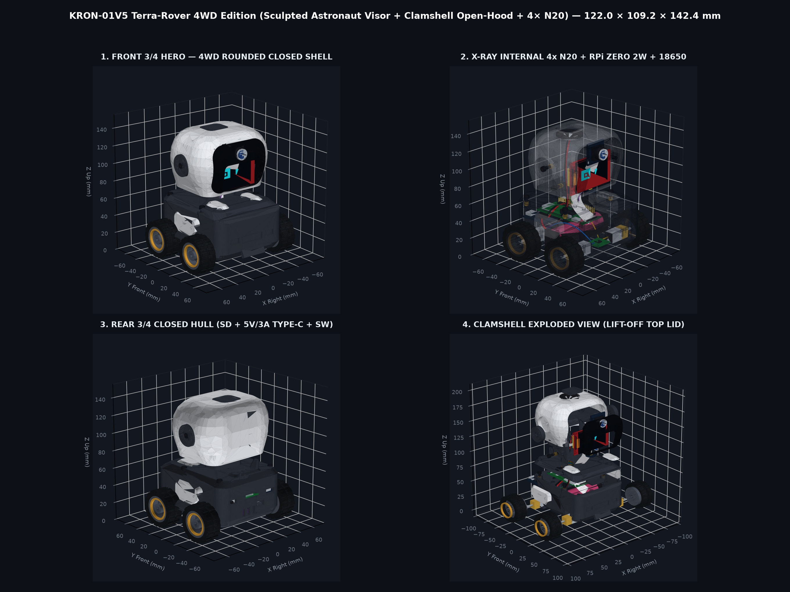

<div align="center">

# KRON-01V5 Terra-Rover

**开源 4WD 赛博视觉 AI 伴侣机器人 — 参数化 B-Rep CAD · 3D 打印制造包 · 全链路数字孪生仿真台**

[](https://github.com/wavachao/kron01-terra-rover/actions/workflows/ci.yml)
[](https://github.com/wavachao/kron01-terra-rover/releases/latest)


<br />


</div>

---

## 目录

- [项目简介与设计亮点](#项目简介与设计亮点)
- [核心工程指标与仿真校验](#核心工程指标与仿真校验)
- [发布包下载与 3D 打印制造](#发布包下载与-3d-打印制造)
- [CAD 工程视图与内部排线](#cad-工程视图与内部排线)
- [硬件 BOM 与电控架构](#硬件-bom-与电控架构)
- [交互式 3D 数字孪生仿真台](#交互式-3d-数字孪生仿真台)
- [本地重建 CAD、DFM 审计与发布](#本地重建-caddfm-审计与发布)
- [项目目录结构](#项目目录结构)
- [详细工程文档](#详细工程文档)

---

## 项目简介与设计亮点

**KRON-01V5 Terra-Rover** 是一款面向桌面视觉交互与具身智能实验的开源四驱（4WD）AI 伴侣机器人。整机采用 Python 参数化实体建模框架 [`build123d`](https://github.com/gumyr/build123d) 从零构建 B-Rep CAD，完整覆盖真实 COTS 硬件干涉校验、电气引脚与 5V/3A 满载防掉电仿真、DFM 水密流形审计以及嘉立创/自用 FDM 双路线交付。

- **低趴宽体四驱工业设计**：`122.0 × 109.2 × 142.4 mm` 紧凑比例，配备 `4× Ø42 mm` 宽体越野胎、6 辐深凹轮毂与暗金细圈，支持原地 360° 零半径差速转向。
- **宇航头盔一体化隐形视觉**：`88 × 68 × 63 mm` 宽扁流线等厚保形头盔配合全黑曲面护目镜面罩（`A08_visor_mask`），将 `OV5647` 160° 广角 CSI 镜头与 `2.0"` ST7789V 表情彩屏无缝隐藏于面罩内，底部敞口可直接套入 `A06` 内胆。
- **免电烙铁掀盖快装（Clamshell）**：外观全封闭流线造型，底盘内宽 `79.0 mm` 直接兼容常规 `76.5 mm` 淘宝 18650 电池盒；顶盖内留 `21.4 mm` 超高净空，直接支持**预焊直针树莓派 Zero 2WH + 标准 14 mm 立式杜邦母头**插接，无需电烙铁改针。
- **零拆机日常开发与维护**：后壁外露 **Micro-SD 快捷槽口**、**5V/3A Type-C 充供电口**、**总电源开关** 及 **USB-OTG 扩展口**；树莓派 Zero 2W 运行完整 Linux，日常迭代通过 Wi-Fi / SSH / OTA 即可完成，无需拆机。
- **全流程自动化 DFM 零碰撞质量门禁**：全部 38 个导出 STL（3 盘分色 22 件 + 嘉立创 16 件）均通过水密单体流形（`Shells == 1`）、全量 B-Rep 零碰撞（打印件↔打印件 0 干涉、打印件↔硬件 0 干涉、`-20° ~ +22°` 头部俯仰 0 碰撞）与 `180×180×180 mm`（Bambu A1 mini）打印尺寸校验。

---

## 核心工程指标与仿真校验

> 以下数据均由仓库内的自动化脚本 [`cad/build_all.py`](cad/build_all.py)、[`cad/dfm_audit.py`](cad/dfm_audit.py) 与 [`cad/simulate_system.py`](cad/simulate_system.py) 实测生成，原始报告见 [`export/build_summary.json`](export/build_summary.json) 与 [`export/netlist_and_sim_report.json`](export/netlist_and_sim_report.json)。

| 工程校验项 | KRON-01V5 实测指标 | 校验结论 |
| :--- | :--- | :---: |
| **整机外包络尺寸** | `122.0 (W) × 109.2 (L) × 142.4 (H) mm`（轴距 `60.0 mm`） | **PASS** |
| **整机质量与静态重心** | 估算总重 `431.5 g`，重心 `Y = +0.37 mm`（居中于 `[-30, +30] mm` 支承多边形内，50/50 配重） | **PASS** |
| **全量 B-Rep 零碰撞审计** | 打印件↔打印件 `0` 干涉 · 打印件↔硬件 `0` 干涉 · `26/26` COTS 间隙 · `-20° ~ +22°` 俯仰 `0` 碰撞 · 立式杜邦头 `0` 干涉 | **PASS** |
| **3D 打印 DFM 审计** | `38 / 38` 个导出 STL 为 100% 水密单体流形（`Watertight=True`, `Shells=1`），适配 `180×180 mm` 热床 | **PASS** |
| **电气连线与 GPIO 审计** | 共 `44` 路连接（含 MIPI CSI-2 FFC 与 4WD 并联），占用 `15` 个 BCM GPIO，`0` 冲突；保留空闲 `I2C1` / `UART0` | **PASS** |
| **5V/3A 满载防掉电** | 4WD + YOLO + 舵机 + 功放峰值 `2337 mA`（IP5328P `77.9%` 负载，DRV8833 `420 mA/路 < 1500 mA`） | **PASS** |
| **续航能力（3000mAh 18650）** | 典型混合视觉交互 `2.45 h`（Linux 待机 `5.89 h` / 持续视觉追踪 `1.55 h`） | **PASS** |
| **头部俯仰舵机裕度** | 需求扭矩 `0.227 kg·cm` vs MG90S 额定 `1.8 kg·cm`（`7.9×` 安全系数） | **PASS** |
| **耗材与打印体积** | 22 个实物零件（16 个独立 STL），约 `214.7 g` PLA / `279.2 cm³`（分 3 盘单色打印） | **PASS** |

---

## 发布包下载与 3D 打印制造

所有经过 CI 门禁验证的制造压缩包均通过 **GitHub Releases** 自动打包发布并附带 `SHA256SUMS.txt` 校验文件：

👉 **[前往 GitHub Releases 下载最新版本](https://github.com/wavachao/kron01-terra-rover/releases/latest)**

### Release 交付物说明

| 发布资产 | 适用场景 | 包含内容 |
| :--- | :--- | :--- |
| [`jlc3dp_ready_16_stl.zip`](https://github.com/wavachao/kron01-terra-rover/releases/latest/download/jlc3dp_ready_16_stl.zip) | **嘉立创 3D 打印（JLC3DP）一键下单** | 16 个归零居中单体水密 STL（共对应 22 个实物件）+ [`嘉立创下单数量与材料对照表.txt`](export/jlc3dp_ready/%E5%98%89%E7%AB%8B%E5%88%9B%E4%B8%8B%E5%8D%95%E6%95%B0%E9%87%8F%E4%B8%8E%E6%9D%90%E6%96%99%E5%AF%B9%E7%85%A7%E8%A1%A8.txt) |
| `kron01-terra-rover-<tag>-fdm-plates-stl.zip` | **自用单色 FDM 打印机** | 按 3 盘分色整理的 22 件 STL + STEP（`plate_A_charcoal` / `plate_B_white` / `plate_C_orange`） |
| [`KRON01_Printed_Assembly.3mf`](https://github.com/wavachao/kron01-terra-rover/releases/latest/download/KRON01_Printed_Assembly.3mf) | **Bambu Studio / OrcaSlicer / PrusaSlicer** | 多零件预分组 3MF 切片工程文件，直接拖入切片软件即可排版 |
| `kron01-terra-rover-<tag>-cad-step.zip` | **二次开发 / SolidWorks / Fusion 360** | 完整总装 STEP、打印件总装 STEP、21 件 COTS 硬件独立 STEP 及 `build_summary.json` |
| `kron01-terra-rover-<tag>-simulator.zip` | **离线仿真与接线查阅** | 独立运行的 3D 数字孪生仿真台 HTML 与电气/运动学仿真报告 JSON |
| `SHA256SUMS.txt` | **完整性校验** | 所有发布文件的 SHA-256 摘要，可执行 `sha256sum -c SHA256SUMS.txt` 验证 |

### 两种制造路线快速指引

<details>
<summary><b>路线 A：嘉立创 3D 打印（JLC3DP）直接下单</b></summary>

1. 从 [Releases](https://github.com/wavachao/kron01-terra-rover/releases/latest) 下载 `jlc3dp_ready_16_stl.zip` 并解压（或直接浏览 [`export/jlc3dp_ready/`](export/jlc3dp_ready/)）。
2. 将 16 个 `.stl` 文件批量上传至嘉立创 3D 打印平台（均为单体水密流形，无需拆件）。
3. 严格按照 [`嘉立创下单数量与材料对照表.txt`](export/jlc3dp_ready/%E5%98%89%E7%AB%8B%E5%88%9B%E4%B8%8B%E5%8D%95%E6%95%B0%E9%87%8F%E4%B8%8E%E6%9D%90%E6%96%99%E5%AF%B9%E7%85%A7%E8%A1%A8.txt) 设置每件的 **数量（x1 / x2 / x4）** 与 **推荐材料**：
   - `01`–`07`、`09`–`10`（结构件/轮毂/内胆）：黑色树脂 或 尼龙 PA12
   - `08`（曲面黑面罩）：高光黑树脂 或 喷亮黑漆
   - `11`–`15`（白色外甲/宇航头盔壳）：9000R / 6060 白色树脂
   - `16`（轮毂细圈 `×4`）：白色树脂自喷暗金/橙漆 或 橙色 PLA

</details>

<details>
<summary><b>路线 B：自用 FDM 3D 打印机（Bambu A1 mini 及以上均可）</b></summary>

- 直接导入 [`export/full_assembly/KRON01_Printed_Assembly.3mf`](export/full_assembly/KRON01_Printed_Assembly.3mf)，或按 3 盘分色切片打印：
  - **盘 A — 哑光枪灰 / 碳黑 PLA**（13 件，`155.7 g`）：[`export/stl_plate_A_charcoal/`](export/stl_plate_A_charcoal/)
  - **盘 B — 珍珠白 PLA**（5 件，`58.1 g`）：[`export/stl_plate_B_white/`](export/stl_plate_B_white/)
  - **盘 C — 暗金 / 香槟橙 PLA**（4 件，`0.9 g`）：[`export/stl_plate_C_orange/`](export/stl_plate_C_orange/)
- **推荐切片参数**：`0.4 mm` 喷嘴、`0.20 mm` 层高、3 层壁厚、15%–20% Gyroid 填充；所有孔位已按 `0.25 mm` 常规间隙与 `0.15 mm` 紧配合预设 FDM 公差。

</details>

---

## CAD 工程视图与内部排线

### 多视图 CAD 总装与掀盖爆炸结构



### 内部四驱 4×N20、居中 18650、树莓派 Zero 2W 与 MIPI CSI-2 排线


---

## 硬件 BOM 与电控架构

### 核心采购清单（全套硬件约 ¥305）

| 子系统 | 型号 / 规格 | 数量 | 参考小计 | 核心职责 |
| :--- | :--- | :---: | :---: | :--- |
| **主控计算** | Raspberry Pi Zero 2WH（预焊直针）+ 铝散热片 + 32GB Micro-SD | 1 | ¥135 | 四核 Linux，本地 OpenCV/YOLO 与云端大模型交互 |
| **视觉感知** | OV5647 5MP 160° 广角 CSI 摄像头 + 22→15pin 15cm FFC | 1 | ¥32 | 隐藏于黑面罩上沿，走独立 MIPI CSI-2（0 GPIO 占用） |
| **表情显示** | 2.0" ST7789V IPS TFT 彩屏（320×240，SPI0） | 1 | ¥20 | 齐平内嵌于面罩，显示动态眼神与状态 UI |
| **全双工语音** | INMP441 I2S 麦克风 + MAX98357A 功放 + 28mm 2W 喇叭 | 1 套 | ¥22 | 共享 I2S 时钟，实现全双工语音唤醒与播报 |
| **四驱动力** | GA12-N20 6V 120RPM 金属减速电机 ×4 + DRV8833 双 H 桥 | 4 + 1 | ¥45 | 左右并联 4WD 差速越野驱动（标准 10mm D 轴） |
| **头部俯仰** | MG90S 金属齿微型舵机 | 1 | ¥9 | 硬件 PWM1 驱动，-20° ~ +22° 无抖动抬头/低头追踪 |
| **供电系统** | IP5328P / SW6106 5V/3A 充放板 + 3000mAh 10A 18650 + 开关 | 1 套 | ¥26 | 15W 稳压输出防掉电重启，支持边充边用 |
| **轮胎与紧固** | Ø42mm 宽体越野橡胶胎 ×4 + M2/M2.5/M3 螺丝与热熔铜螺母 | 1 套 | ¥16 | 越野抓地、电机防甩压板及外壳机械定位锁紧 |

### Raspberry Pi Zero 2W 总线与 GPIO 分配速览

| 总线 / 功能 | 使用引脚（BCM GPIO） | 备注 |
| :--- | :--- | :--- |
| **MIPI CSI-2 摄像头** | 专用 22-pin CSI 接口 | 15cm FFC 排线，不占用 GPIO |
| **ST7789V 彩屏（SPI0）** | `GPIO8 (CE0)` / `GPIO10 (MOSI)` / `GPIO11 (SCLK)` / `GPIO12 (BLK)` / `GPIO24 (RST)` / `GPIO25 (DC)` | 40 MHz 硬件 SPI0 + PWM0 背光 |
| **全双工 I2S 音频** | `GPIO18 (BCLK*)` / `GPIO19 (LRCLK*)` / `GPIO20 (DIN)` / `GPIO21 (DOUT)` | INMP441 与 MAX98357A 共享时钟 |
| **DRV8833 四驱控制** | `GPIO5` / `GPIO6`（左侧 FL+RL），`GPIO22` / `GPIO23`（右侧 FR+RR） | 左右各两路 N20 并联 |
| **MG90S 头部舵机** | `GPIO13 (PWM1)` | 独立硬件 PWM1，零软件抖动 |
| **预留扩展总线** | `I2C1 (GPIO2/3)`、`UART0 (GPIO14/15)`、`GPIO4/7/9/16/17/26/27` | 便于扩展 IMU / ToF / 触摸传感器 |

---

## 交互式 3D 数字孪生仿真台

本仓库内置零依赖的浏览器端全链路数字孪生仿真台 [`simulator/kron01_full_simulator.html`](simulator/kron01_full_simulator.html)，下载或克隆后直接双击在现代浏览器中打开即可体验：

1. **3D 实景精模与掀盖快装演示**：支持 360° 轨道视角、`W/A/S/D` 四驱键盘驾驶、一键「掀开顶盖」与 X 光透视内部硬件布局。
2. **44 路真实连线原理图**：按电源树 / MIPI CSI / SPI0 / I2S / 4WD 电机 / 舵机分类高亮查看每一路物理接线。
3. **4 通道实时示波器与功耗/重心遥测**：实时观察不同 AI 负载下的 5V/3A 电流裕度、电池压降与 50/50 重心校验。

---

## 本地重建 CAD、DFM 审计与发布

### 1. 环境安装

仅运行 **DFM 网格审计** 与 **电气仿真**（轻量依赖）：

```bash
pip install trimesh numpy scipy
```

如需从源码 **完整重建所有 B-Rep CAD、STEP/STL/3MF 与工程视图**：

```bash
pip install -r cad/requirements.txt
```

### 2. 常用工程命令

```bash
# 1) 完整重建 CAD、COTS 干涉检查、导出 STEP/STL/3MF/JLC3DP 与渲染工程图
python cad/build_all.py

# 2) 运行 38 个 STL 水密性、单体流形 (shells == 1) 与 180mm 打印热床审计
python cad/dfm_audit.py

# 3) 运行 44 路电气网表、5V/3A 满载功耗与 4WD 动力学/重心仿真
python cad/simulate_system.py

# 4) 本地生成与 GitHub Release 完全一致的制造发布包及 SHA256SUMS.txt
python scripts/package_release.py --version v1.0.0 --output dist
(cd dist && sha256sum -c SHA256SUMS.txt)
```

### 3. 触发自动化 GitHub Release

仓库已配置 [`.github/workflows/ci.yml`](.github/workflows/ci.yml) 与 [`.github/workflows/release.yml`](.github/workflows/release.yml)：

- **方式一（推送语义化版本标签）**：
  ```bash
  git tag v1.0.0
  git push origin v1.0.0
  ```
- **方式二（GitHub Actions 手动触发）**：在仓库 **Actions → Release Manufacturing Packages → Run workflow** 中输入版本号（如 `v1.0.0`），流水线将自动通过全部 DFM / 电气门禁并发布包含 `jlc3dp_ready_16_stl.zip` 在内的全套制造包与 `SHA256SUMS.txt`。

---

## 项目目录结构

```text
kron01-terra-rover/
├── .github/workflows/
│   ├── ci.yml                              # Push / PR 自动化 DFM、电气仿真与打包验证
│   └── release.yml                         # Tag / 手动触发的制造包 GitHub Release 流水线
├── cad/
│   ├── config.py                           # 全局参数化尺寸、FDM 公差与 COTS 坐标定义
│   ├── cots_hardware.py                    # 21 件真实 COTS 硬件参数化 B-Rep 建模
│   ├── printed_chassis.py                  # 底盘下盆、掀盖顶罩、电机压板与 4WD 轮毂建模
│   ├── printed_head.py                     # 宇航头盔壳、内胆、黑面罩与耳罩建模
│   ├── build_all.py                        # 主构建脚本（总装、干涉检查、STL/STEP/3MF 导出与渲染）
│   ├── dfm_audit.py                        # 38-STL 水密单体流形与打印热床尺寸审计脚本
│   ├── simulate_system.py                  # 44 路网表校验、5V/3A 满载与动力学重心仿真
│   ├── import_external_step.py             # 外部供应商 STEP 替换导入辅助工具
│   └── requirements.txt                    # Python CAD 与 DFM 审计依赖清单
├── scripts/
│   └── package_release.py                  # 确定性 Release 制造包生成与 SHA-256 校验脚本
├── export/
│   ├── jlc3dp_ready/                       # 嘉立创 3D 打印 16 个居中单体 STL 与下单对照表
│   ├── stl_plate_A_charcoal/               # FDM 盘 A：哑光枪灰 / 黑色零件（13 件 STL + STEP）
│   ├── stl_plate_B_white/                  # FDM 盘 B：珍珠白外壳零件（5 件 STL + STEP）
│   ├── stl_plate_C_orange/                 # FDM 盘 C：暗金 / 香槟橙点缀件（4 件 STL + STEP）
│   ├── full_assembly/                      # 总装 STEP 与多零件 3MF 切片包
│   ├── cots_step/                          # 21 件真实外购电子/机械硬件 STEP 库
│   ├── build_summary.json                  # 自动生成的尺寸、耗材与 26 组干涉审计汇总
│   ├── netlist_and_sim_report.json         # 自动生成的 44 路网表与功耗/重心报告
│   └── viewer_meshes.json                  # 轻量 WebGL 分色网格数据包
├── simulator/
│   └── kron01_full_simulator.html          # 独立可运行的 3D 数字孪生与原理图仿真台
└── docs/
    ├── DESIGN_REPORT.md                    # 工业设计演进、装配流程图与完整 DFM/DFA 工程报告
    └── images/                             # 概念渲染图、CAD 工程四视图与内部排线图
```

---

## 详细工程文档

- 📘 **[完整工业设计与 DFM/DFA 工程报告（docs/DESIGN_REPORT.md）](docs/DESIGN_REPORT.md)** — 包含结构设计演进、Mermaid 五步装配流程图、热熔螺母/定位销加固细节及免拆机维护方案。
- 📋 **[嘉立创 3D 打印下单数量与材料对照表](export/jlc3dp_ready/%E5%98%89%E7%AB%8B%E5%88%9B%E4%B8%8B%E5%8D%95%E6%95%B0%E9%87%8F%E4%B8%8E%E6%9D%90%E6%96%99%E5%AF%B9%E7%85%A7%E8%A1%A8.txt)** — 16 个独立 STL 的尺寸、体积、下单数量与推荐树脂/尼龙材料清单。
