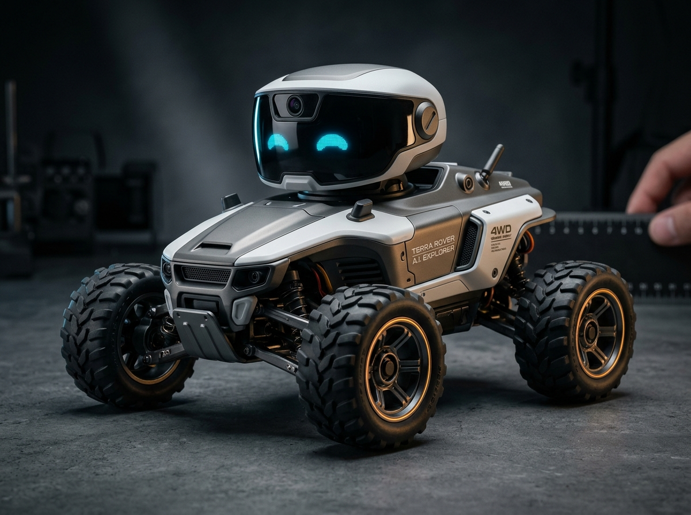
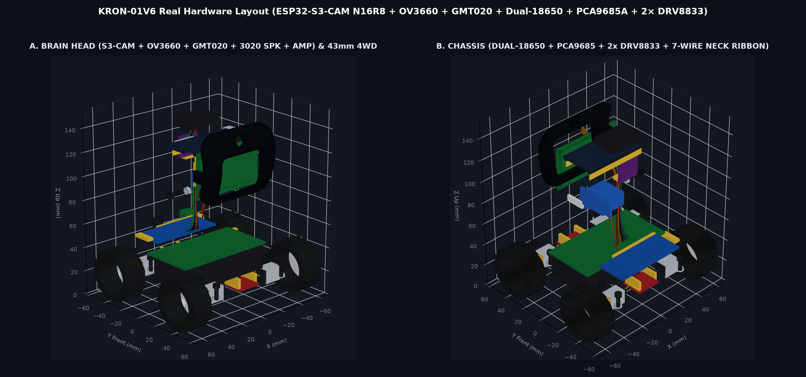

<div align="center">

# KRON-01V6 Terra-Rover (v2.0.0)

**开源 4WD 赛博视觉 AI 伴侣机器人（ESP32-S3-CAM N16R8 零焊接高容错版）**

[](https://github.com/wavachao/kron01-terra-rover/actions/workflows/ci.yml)
[](https://github.com/wavachao/kron01-terra-rover/releases/latest)


<br />



</div>

---

## 目录

- [v2.0.0 核心升级亮点（全链路零焊接 + ±0.4mm 高容错）](#v200-核心升级亮点全链路零焊接--04mm-高容错)
- [核心工程指标与仿真校验](#核心工程指标与仿真校验)
- [发布包下载与 3D 打印制造（仅 14 个 STL！）](#发布包下载与-3d-打印制造仅-14-个-stl)
- [CAD 工程视图与内部排线](#cad-工程视图与内部排线)
- [零焊接 1-对-1 杜邦线引脚对照表](#零焊接-1-对-1-杜邦线引脚对照表)
- [本地重建 CAD、DFM 审计与发布](#本地重建-caddfm-审计与发布)
- [项目目录结构](#项目目录结构)

---

## v2.0.0 核心升级亮点（全链路零焊接 + ±0.4mm 高容错）

**KRON-01V6 Terra-Rover (v2.0.0)** 面向 **ESP32-S3-CAM N16R8 + OV3660 云端多模态 AI** 极致性价比方案（全套电子+机械件约 ¥229，**100% 免电烙铁直插**）彻底重构全部 B-Rep 参数化 CAD：

- **头脑分体架构（仅 7 根超软杜邦线穿颈！）**：
  - **大脑头盔（`94 × 76 × 67 mm`）**：内置 `ESP32-S3-CAM N16R8`、`OV3660` 短排线镜头（紧贴黑面罩上沿，无需延长线）、`GMT020-02` 2.0 寸 IPS 彩屏、`3020` 腔体喇叭、`MAX98357A` I2S 功放与 `INMP441` 麦克风；
  - **四驱动力底盘（`94 × 120 mm`）**：正中 50/50 配重 `双节 18650 Type-C 电源板（85×44×23mm，5000mAh 1S2P）`，前后轴正中双 `DRV8833` 1-对-1 直插四路预焊 `GA12-N20` 2P 杜邦线，后上层架空 `PCA9685A` 16 路 I2C PWM 驱动板；
  - **右侧腰部免拆机电源窗**：`A01` 侧壁与 `B03_side_fairing_R` 预留战术拱窗，位于前后车轮之间，**无需掀盖即可插 Type-C 充电、拨动 ON/OFF 总开关、查看 4 颗电量灯（25/50/75/100%）**。
- **针对实板 ±0.2~0.5mm 贴片/切割公差 + 嘉立创 SLA 收缩的防卡死设计**：
  - 所有板卡槽位预留 **`+0.7 ~ +0.8 mm / 边`** 宽裕容差，**取消易错位的刚性 M2/M2.5 四孔对位**（改用围栏卡槽/双侧承托架），已通过 **全模块 +0.8 mm（±0.4 mm/边，双倍偏差）压力测试 0.000 mm³ 干涉**；
  - `A08` 黑面罩屏幕窗口扩大至 `42.8 × 32.6 mm`（四周多留 `+1.0 mm`），彻底吸收 `GMT020-02` 屏幕玻璃贴合偏移；
  - 全部榫卯滑槽预留 **`0.28 ~ 0.35 mm` SLA 间隙**，装拆顺滑绝不卡死。
- **全机统一 M3 螺丝螺母 + 直装 43×18mm 成品橡胶轮**：
  - 彻底取消 M2 / M2.5 紧固件，整机仅需 **9 颗 M3×10 螺丝 + 9 颗 M3 DIN 934 六角螺母**（外加舵机自带螺丝）；
  - 取消打印轮毂 `A04` 与轮圈 `C03`（省去 **8 个打印件**，嘉立创仅需打印 **14 个独立 STL / 15 个实物件 / 2 色**），直接套入淘宝成品 `43×18 mm` N20 D 轴橡胶轮！

---

## 核心工程指标与仿真校验

> 以下数据由 [`cad/build_all.py`](cad/build_all.py)、[`cad/dfm_audit.py`](cad/dfm_audit.py) 与 [`cad/simulate_system.py`](cad/simulate_system.py) 自动生成，原始报告见 [`export/build_summary.json`](export/build_summary.json) 与 [`export/netlist_and_sim_report.json`](export/netlist_and_sim_report.json)。

| 工程校验项 | KRON-01V6 (v2.0.0) 实测指标 | 校验结论 |
| :--- | :--- | :---: |
| **整机外包络尺寸** | `133.0 (W) × 125.8 (L) × 154.0 (H) mm`（轴距 `76.0 mm`，四轮着地 `Z_min = 0.00 mm`） | **PASS** |
| **整机质量与静态重心** | 估算总重 `536.5 g`，重心 `Y = +0.02 mm`（居中于 `[-38, +38] mm` 支承多边形，50/50 配重） | **PASS** |
| **全量 B-Rep 零碰撞审计** | 打印件↔打印件 `0` 干涉 · 打印件↔硬件 `0` 干涉 · `26/26` COTS 间隙 · `-20° ~ +22°` 俯仰 `0` 碰撞 | **PASS** |
| **装拆路径 & ±0.4mm 压力测试** | `8/8` 榫卯全路径扫掠 + `9/9` 模块 `+0.8 mm` 放大极限压力测试均 `0.000 mm³` 干涉 | **PASS** |
| **3D 打印 DFM 审计** | `29 / 29` 个导出 STL 为 100% 水密单体流形（`Watertight=True`, `Shells=1`），适配 `180×180 mm` 热床 | **PASS** |
| **电气连线与 GPIO 审计** | `46` 路 1-对-1 杜邦直插，占用 `13` 个 S3 空闲 GPIO（`0` 冲突，完全避开摄像头/PSRAM/USB），仅 `7` 线穿颈 | **PASS** |
| **5V/3A 满载与续航** | 4WD+视觉峰值 `1837 mA`（`61.2%` 负载）；双节 EVE 18650（`5000 mAh`）混合 AI 续航 **`6.35 小时`** | **PASS** |
| **头部俯仰舵机裕度** | 需求扭矩 `0.290 kg·cm` vs MG90S 额定 `1.8 kg·cm`（`6.2×` 安全系数） | **PASS** |
| **嘉立创打印件数与体积** | **14 个独立 STL（15 个实物件，分 2 色）**，总打印体积 `343.7 cm³`（约 `264.7 g` PLA） | **PASS** |

---

## 发布包下载与 3D 打印制造（仅 14 个 STL！）

👉 **[前往 GitHub Releases 下载最新版本](https://github.com/wavachao/kron01-terra-rover/releases/latest)**

| 发布资产 | 适用场景 | 包含内容 |
| :--- | :--- | :--- |
| [`jlc3dp_ready_14_stl.zip`](https://github.com/wavachao/kron01-terra-rover/releases/latest/download/jlc3dp_ready_14_stl.zip) | **嘉立创 3D 打印（JLC3DP）一键下单** | 14 个归零居中单体水密 STL（对应 15 个实物件）+ [`嘉立创下单数量与材料对照表.txt`](export/jlc3dp_ready/%E5%98%89%E7%AB%8B%E5%88%9B%E4%B8%8B%E5%8D%95%E6%95%B0%E9%87%8F%E4%B8%8E%E6%9D%90%E6%96%99%E5%AF%B9%E7%85%A7%E8%A1%A8.txt) |
| `kron01-terra-rover-<tag>-fdm-plates-stl.zip` | **自用单色 FDM 打印机** | 2 盘分色 15 件 STL + STEP（`plate_A_charcoal` / `plate_B_white`） |
| [`KRON01_Printed_Assembly.3mf`](https://github.com/wavachao/kron01-terra-rover/releases/latest/download/KRON01_Printed_Assembly.3mf) | **Bambu Studio / OrcaSlicer** | 多零件预分组 3MF 切片工程文件 |
| `kron01-terra-rover-<tag>-cad-step.zip` | **二次开发 / SolidWorks / Fusion 360** | 完整总装 STEP、打印件总装 STEP、21 件 COTS 硬件 STEP 及 `build_summary.json` |
| `SHA256SUMS.txt` | **完整性校验** | 所有发布文件的 SHA-256 摘要 |

---

## CAD 工程视图与内部排线

### 多视图 CAD 总装、右侧电源窗与掀盖爆炸结构


### 内部硬件布局（头脑 S3-CAM + 居中双 18650 + PCA9685 + 双 DRV8833 + 7 线穿颈）



---

## 零焊接 1-对-1 杜邦线引脚对照表

> 全部信号与电源均为 **1-对-1 母对母杜邦直插**（零并线、零面包板、零焊接）；烧录固件请优先使用 S3-CAM 的原生 `USB` Type-C 口（`GPIO19/20`），避免占用 `GPIO43/44`。

| 模块 | 模块引脚 | 连接目标 | 备注 |
| :--- | :--- | :--- | :--- |
| **穿颈 7 线排线** | `5V / GND / 5V / 3V3 / GND / SDA / SCL` | `双18650电源板` & `PCA9685A` ↔ 头部 | 从 40P 20cm 杜邦排线撕下 7 根穿颈 |
| **PCA9685A（I2C）** | `SDA` / `SCL` / `VCC` / `V+` / `GND` | `S3 GPIO1` / `S3 GPIO2` / `电源板 3V3` / `电源板 5V` / `电源板 GND` | 仅 2 根信号线控 4 电机+舵机，余 7 路 |
| **GMT020-02 彩屏** | `SCL` / `SDA` / `RES` / `DC` / `CS` / `VCC` / `GND` / `BLK` | `GPIO21` / `GPIO47` / `GPIO14` / `GPIO41` / `GPIO42` / `S3 3V3` / `S3 GND` / `穿颈 3V3` | 头内短线直插（10cm 杜邦） |
| **INMP441 麦克风** | `SCK` / `WS` / `SD` / `VDD` / `GND` / `L/R` | `GPIO39` / `GPIO40` / `GPIO38` / `S3 3V3` / `S3 GND` / `穿颈 GND` | 独立硬件 I2S1，左声道接地 |
| **MAX98357A 功放** | `BCLK` / `LRC` / `DIN` / `VIN` / `GND` / `SPK±` | `GPIO3` / `GPIO43` / `GPIO44` / `穿颈 5V` / `S3 GND` / `3020 喇叭螺丝端子` | 独立硬件 I2S0，喇叭线仅 2cm |
| **MG90S 舵机** | `3P 原装母头` | `PCA9685A CH0` | 原装 3P 杜邦直插 |
| **DRV8833 #1（前驱）** | `IN1~IN4` / `VCC,GND` / `OUT1~4` | `PCA9685A CH1~CH4` / `电源板 5V,GND` / `FL,FR 电机原装 2P` | 若板卡 `EEP/SLP` 未上拉，接 `3V3` |
| **DRV8833 #2（后驱）** | `IN1~IN4` / `VCC,GND` / `OUT1~4` | `PCA9685A CH5~CH8` / `电源板 5V,GND` / `RL,RR 电机原装 2P` | 4 路 N20 原装 2P 直插，免并线 |

---

## 本地重建 CAD、DFM 审计与发布

```bash
# 1) 完整重建 CAD、26 组 COTS 间隙校验、导出 14 件 JLC3DP STL / STEP / 3MF 与渲染工程图
python3 cad/build_all.py

# 2) 运行 29 个 STL 水密单体流形 + 全量 B-Rep 零碰撞 + 头部俯仰 -20°..+22° 审计
python3 cad/dfm_audit.py --full

# 3) 运行 46 路 1-对-1 网表、双 18650 续航与 4WD 动力学重心仿真
python3 cad/simulate_system.py

# 4) 生成与 GitHub Release 一致的制造发布包及 SHA256SUMS.txt
python3 scripts/package_release.py --version v2.0.0 --output dist
(cd dist && sha256sum -c SHA256SUMS.txt)
```

---

## 项目目录结构

```text
kron01-terra-rover/
├── .github/workflows/
│   ├── ci.yml                              # Push / PR 自动化 29-STL DFM、电气仿真与打包验证
│   └── release.yml                         # Tag / 手动触发的制造包 GitHub Release 流水线
├── cad/
│   ├── config.py                           # v2.0.0 全局参数化尺寸、±0.7mm 宽容度与 M3 统一公差
│   ├── cots_hardware.py                    # 21 件真实 COTS 硬件参数化 B-Rep 建模
│   ├── printed_chassis.py                  # 底盘下盆（含右腰电源窗）、5 点滑榫顶罩、尾锁销与 M3 压板
│   ├── printed_head.py                     # 94×76×67mm 大脑头盔壳、内胆、宽窗口面罩与 90° 旋锁耳罩
│   ├── build_all.py                        # 主构建脚本（总装、26 组干涉、14 件 JLC3DP STL 与渲染）
│   ├── dfm_audit.py                        # 29-STL 水密单体流形、B-Rep 零碰撞与动态俯仰审计脚本
│   └── simulate_system.py                  # 46 路 S3-CAM 1-对-1 网表、5000mAh 续航与重心仿真
├── scripts/
│   └── package_release.py                  # 确定性 Release 制造包生成与 SHA-256 校验脚本
├── export/
│   ├── jlc3dp_ready/                       # 嘉立创 3D 打印 14 个居中单体 STL 与下单对照表
│   ├── stl_plate_A_charcoal/               # 盘 A：哑光枪灰 / 黑色零件（10 件 STL + STEP）
│   ├── stl_plate_B_white/                  # 盘 B：珍珠白外壳零件（5 件 STL + STEP）
│   ├── full_assembly/                      # 总装 STEP 与多零件 3MF 切片包
│   ├── cots_step/                          # 21 件真实外购电子/机械硬件 STEP 库
│   ├── build_summary.json                  # 自动生成的尺寸、耗材与 26 组干涉审计汇总
│   ├── netlist_and_sim_report.json         # 自动生成的 46 路网表与功耗/重心报告
│   └── viewer_meshes.json                  # 轻量 WebGL 分色网格数据包
└── docs/
    ├── DESIGN_REPORT.md                    # 详细工程报告、公差缓冲设计与装配流程
    └── images/                             # 概念渲染图、CAD 工程四视图与内部排线图
```
