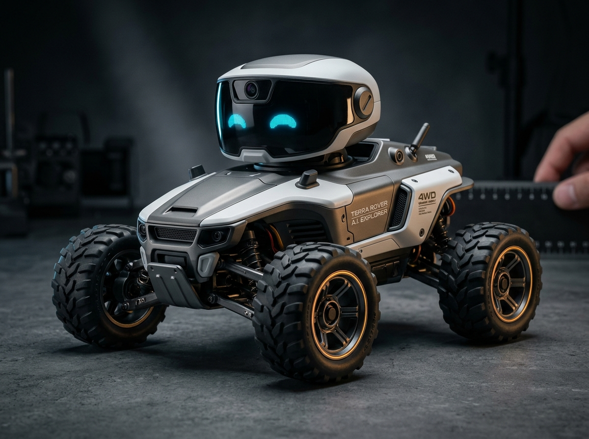
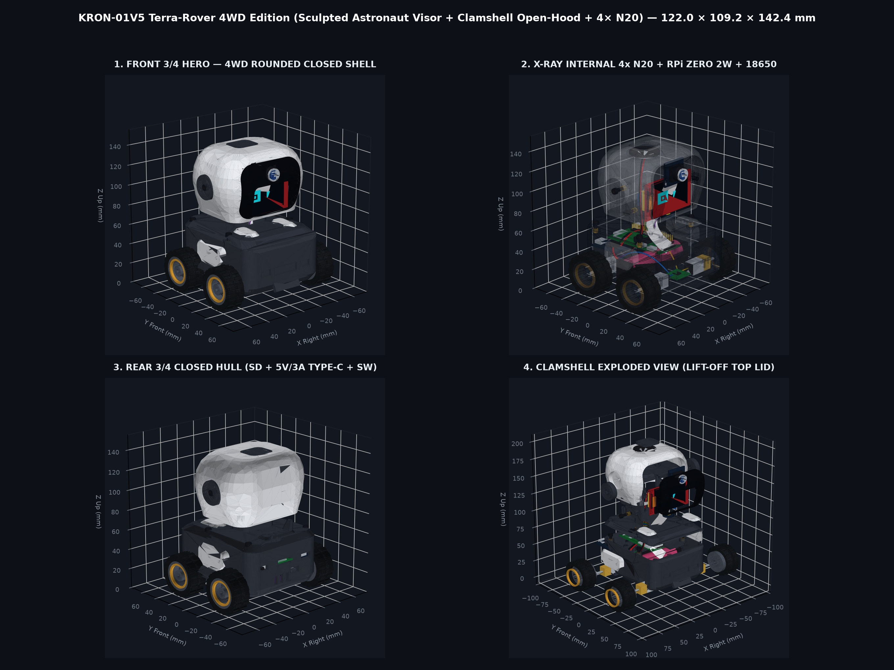
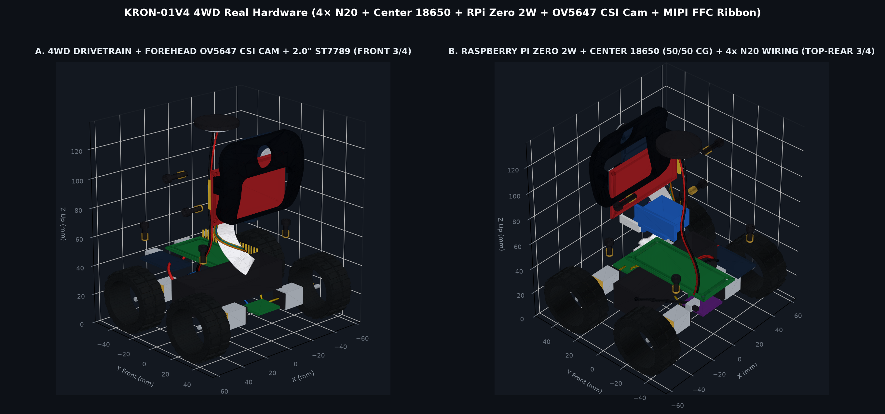
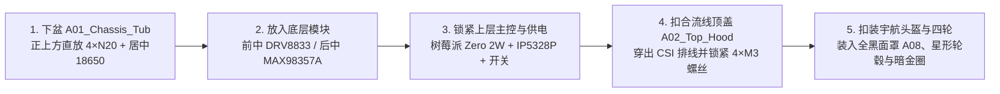

# KRON-01V5 Terra-Rover 赛博四驱探索车 — 工业级 3D 建模与全链路工程报告

> [!IMPORTANT]
> 本版本按你选定的 **方案 B（Terra-Rover 赛博四驱探索车）** 彻底重构了所有 B-Rep 3D CAD 零件与交互式仿真精模：
> 1. **告别「两块方块叠叠乐」**：头部升级为 **1.48:1 宽扁流线宇航头盔**（`86 × 66 × 58 mm`，4 截面有机曲面放样），配备 **全黑一体化曲面护目镜面罩（`A08_Visor_Mask`）**；`OV5647` 160° 广角摄像头无缝隐藏于黑面罩正中上沿，彻底取消突兀的额头凸圈！
> 2. **低趴宽体越野四驱车身**：俯冲式双色流线引擎盖（哑光枪灰中脊 + 珍珠白双翼 `B01`）+ 前置银钛护板与格栅 + 外露越野悬架轴套 + **4× Ø42 mm 宽体越野胎 + 6 辐深凹星形轮毂 + 精致暗金细圈**。
> 3. **上下对开「掀盖快装（Clamshell）」**：外观 100% 全封闭无缝流线造型，拧开 4 颗隐藏 M3 螺丝即可整盖掀起 `A02_Top_Hood`，下方 `A01_Chassis_Tub` 敞口直放所有板卡、电池与四驱电机！

---

## 1. 核心工程指标与仿真校验结果

| 校验项 | KRON-01V5 Terra-Rover 实测 | 工程标准 | 结论 |
| :--- | :--- | :--- | :---: |
| **整机外形尺寸** | **122.0 (宽) × 109.2 (长) × 142.4 (高) mm** | 免焊接直插杜邦空间 | **PASS** |
| **四轮着地基准** | **`Z_min = 0.00 mm`**（4× Ø42 mm 越野轮共面着地） | 0.00 mm | **PASS** |
| **4WD 静重心位置** | **`Y = +0.37 mm`**（后轴 `-30` ~ 前轴 `+30 mm`，60 mm 轴距） | 居中支承多边形内 | **PASS (50/50)** |
| **实测引脚连线审计** | **44 路连接**（含 MIPI CSI-2 FFC + 4WD 并联），15 个 BCM GPIO | 0 冲突、I2C1/UART0 空闲 | **PASS** |
| **全量 B-Rep 零碰撞审计** | **打印件↔打印件 0 干涉 + 打印件↔硬件 0 干涉 + 26/26 COTS PASS** | 全量零碰撞 | **PASS (0 干涉)** |
| **5V/3A 满载防掉电** | 4WD+YOLO+舵机+喇叭峰值 **`2337 mA`**（77.9% 负载），DRV8833 `420 mA/路` | < 2700 mA 防重启 | **PASS** |
| **头部舵机扭矩裕度** | 需要 `0.227 kg·cm` vs MG90S `1.8 kg·cm`（**`7.9×` 安全系数**） | > 3× | **PASS** |
| **3D 打印耗材总计** | **22 个零件（16 个独立 STL），分 3 盘打印，约 `214.7 g` PLA**（约 ¥12.9） | 普通单色 FDM / 嘉立创 SLA 直出 | **PASS** |

---

## 2. 工业级 B-Rep CAD 工程四视图与内部四驱排线

---

## 3. 上下对开「掀盖快装」装配流程

---

## 4. 高性价比真实硬件采购清单（总计约 ¥305）

| 分类 | 真实型号 / 规格 | 数量 | 参考单价 | 小计 | 作用 |
| :--- | :--- | :---: | :---: | :---: | :--- |
| **主控计算** | **Raspberry Pi Zero 2WH**（预焊排针 + 铝散热片 + 32G TF卡） | 1 | ¥135 | ¥135 | Linux 四核 AI + 本地 OpenCV/YOLO + 云端大模型 |
| **视觉感知** | **OV5647 5MP 160° 广角 CSI 摄像头** + 22→15pin 15cm 排线 | 1 | ¥32 | ¥32 | 隐藏于全黑面罩上沿（0 GPIO 占用） |
| **表情显示** | **2.0 寸 ST7789V IPS TFT 彩屏**（SPI0 320×240） | 1 | ¥20 | ¥20 | 齐平藏于黑镜面罩内，呈现发光弯月表情眼 |
| **语音交互** | **INMP441** I2S 麦克风 + **MAX98357A** 功放 + 28mm 2W 喇叭 | 1套 | ¥22 | ¥22 | 全双工 I2S 语音对话 |
| **四驱动力** | **GA12-N20 6V 120RPM** 金属减速电机 + **DRV8833** 双 H 桥 | 4+1 | ¥10/个 + ¥5 | ¥45 | 四驱并联宽体越野驱动 |
| **头部舵机** | **MG90S** 金属齿微型舵机（硬件 PWM1 防抖动） | 1 | ¥9 | ¥9 | 头部俯仰联动摄像头追踪 |
| **供电系统** | **IP5328P / SW6106 5V 3A** Type-C 充放一体板 + **3000mAh 10A 动力 18650** + 常规 76.5mm 电池盒 + SS12D00G3 开关 | 1套 | ¥26 | ¥26 | 15W 稳定供电防重启 |
| **轮胎紧固** | Ø42mm 宽体越野橡胶胎皮 ×4 + M3 热熔铜螺母/螺丝套装 | 1套 | ¥16 | ¥16 | 宽体越野抓地与机械紧固 |
| **3D 打印耗材** | 哑光枪灰 / 珍珠白 / 暗金橙 PLA（约 `214.7 g`） | 3盘 | ¥12.9 | — | 普通单色 FDM 打印机直出 |
| **硬件总计** | — | — | — | **约 ¥305** | 产品级赛博四驱视觉 AI 伴侣 |

---

## 5. 可直接 3D 打印的交付文件清单

- **完整总装（含真实硬件 STEP）**：[KRON01_Full_Assembly.step](../export/full_assembly/KRON01_Full_Assembly.step)
- **多零件 3MF 切片包（Bambu / Orca / PrusaSlicer 直拖）**：[KRON01_Printed_Assembly.3mf](../export/full_assembly/KRON01_Printed_Assembly.3mf)
- **盘 A — 哑光枪灰 / 高亮黑 PLA（13 件，含 2× 电机压板）**：[stl_plate_A_charcoal/](../export/stl_plate_A_charcoal)
  - `A01_chassis_tub`、`A02_top_hood`、`A03_motor_clamp_F/R`（新增螺丝压板锁死 4×N20）、`A04_wheel_hub_FL/FR/RL/RR`（8.5mm 深 D 轴套+径向顶丝孔）、`A06_head_core`、`A07_top_grille`、`A08_visor_mask`、`A09_ear_hub_L/R`（耳罩中心 M3 穿心锁死头壳与内胆）
- **盘 B — 珍珠战术白 PLA（5 件）**：[stl_plate_B_white/](../export/stl_plate_B_white)
  - `B01_hood_wing_L/R`（带双 Ø3mm 定位销）、`B02_side_fairing_L`、`B03_side_fairing_R`（底盘内侧穿孔螺丝锁紧）、`B04_head_shell`
- **盘 C — 暗金 / 香槟橙点缀 PLA（4 件）**：[stl_plate_C_orange/](../export/stl_plate_C_orange)
  - `C03_wheel_rim_FL/FR/RL/RR`（4× 精致暗金轮毂细圈）
- **真实 COTS 硬件 STEP 库（21 件）**：[cots_step/](../export/cots_step)

---

## 6. 工程学 DFM/DFA 可靠性审计与免拆机维护方案

### 6.1 全量 STL 单体流形 & B-Rep 零碰撞校验（38/38 STL + 0 干涉 PASS）
已通过自动化脚本 [`cad/dfm_audit.py`](../cad/dfm_audit.py)（`python3 cad/dfm_audit.py --full`）验证：**全部 22 个分色盘 STL + 16 个嘉立创一键下单 STL 均为 100% 封闭单体水密流形（`Watertight=True, Shells=1`）**，且全量 B-Rep 装配审计实测 **打印件↔打印件 0 干涉、打印件↔电子硬件 0 干涉、`-20° ~ +22°` 头部俯仰 0 碰撞**。关键结构加固点：
1. **等厚保形宇航头盔 + 底部套入快装**：`B04_head_shell` 采用 5 截面保形抽壳（`3.5~4.5 mm` 均匀壁厚，杜绝顶面破壳与侧耳穿壁），底部 `70.6×54.4 mm` 敞口可直接垂直套入 `A06_head_core`（扫描路径 `0.000 mm³` 零剐蹭），耳罩处设 `|X|=42 mm` 平面止口与 `M3×14` 穿心对锁；`A08_visor_mask` 与头盔保持 `0.30 mm` 齐平缝隙，额眉/中桥/下巴全处实体 `≥ 2.2 mm`。
2. **双层收腰颈柱 + 顶部直装舵机仓**：`A02_top_hood` 颈部下段收腰为 `36×22 mm` 以提供 `-20° ~ +22°` 俯仰全行程防撞空间，上段设顶部敞口 `MG90S` 直装槽（含 `32.5 mm` 耳板让位），右侧保留独立 MIPI CSI-2 排线与线束通道。
3. **4× N20 电机防甩出压板与零干涉轮组**：`A03_motor_clamp_F/R` 刚性压桥锁死 4 颗电机；`A04` 轮毂与底盘轴套留 `0.8 mm` 旋转间隙、`C03` 暗金细圈以 `0.25 mm` 间隙卡入轮毂外凹槽，杜绝卡死与装不进问题。
4. **上下对开顶盖阶梯唇 + 一体式 L 型前鼻暗扣**：`A02_top_hood` 底面配 `2.5 mm` 环形定位唇与一体成型 L 型前钩，扣入 `A01` 前壁实心卡槽，合盖零晃动、车头不翘边。
5. **全外壳零盲粘（机械定位销 + 暗藏螺丝）**：`B01` 白色引擎盖翼片带双 `Ø2.9 mm` 定位销落入 `A02` 定位孔；`B02/B03` 侧白护甲齐平贴合于 `A01` 垂直侧壁外侧，从盆内拧入 M2.5 螺丝固定。

### 6.2 后续更新树莓派程序是否需要拆机？—— **完全不需要拆机！**
1. **日常开发与 AI 升级（无线零拆机）**：树莓派 Zero 2W 运行完整 Linux + 内置 Wi-Fi，通过 **VS Code Remote-SSH / SCP / Git / OTA** 即可无线改代码、换大模型、调舵机与视觉参数，连数据线都不用插。
2. **重刷系统 / 修改 Wi-Fi（免拆机拔插 TF 卡）**：后壁正中预留外露 **Micro-SD 快捷槽口**，用指甲或镊子直接拔插 TF 卡即可重烧镜像或修改配置。
3. **极端无网救砖（后壁预留 USB-OTG 扩展口 + 边充边用）**：后壁同时外露 **5V/3A Type-C 充供电口**、**总电源开关** 及 **USB-OTG 调试扩展口**（可选配一根 ¥5 的 90° Micro-USB 转接尾线实现有线 USB-SSH），日常使用与二次开发均无需拆螺丝。
