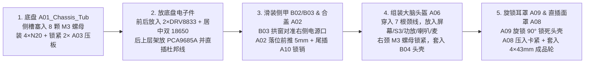

# KRON-01V6 Terra-Rover (v2.0.0) — ESP32-S3-CAM 零焊接高容错工程报告

> [!IMPORTANT]
> **v2.0.0 核心定位**：面向已采购的 **ESP32-S3-CAM N16R8 + OV3660 + GMT020-02 + 双节 18650 电源板 + PCA9685A + 双 DRV8833 + 4×N20 + 4×43mm 成品轮** 零焊接方案，全面吸收 **开发板贴片/切板 ±0.2~0.5 mm 公差** 与 **嘉立创 SLA 光敏树脂 ±0.15~0.20 mm 收缩偏差**，确保 3D 打印到手一次装成！

---

## 1. 核心工程指标与仿真校验结果

| 校验项 | KRON-01V6 (v2.0.0) 实测 | 工程标准 | 结论 |
| :--- | :--- | :--- | :---: |
| **整机外形尺寸** | **133.0 (宽) × 125.8 (长) × 154.0 (高) mm** | 轴距 76 mm，免焊直插大空间 | **PASS** |
| **四轮着地基准** | **`Z_min = 0.00 mm`**（4× 成品 Ø43×18 mm 橡胶轮） | 0.00 mm | **PASS** |
| **4WD 静重心位置** | **`Y = +0.02 mm`**（后轴 `-38` ~ 前轴 `+38 mm`） | 居中支承多边形内 | **PASS (50/50)** |
| **1-对-1 杜邦网表** | **46 路连接**，13 个 S3 空闲 GPIO，仅 **7 根穿颈线** | 0 冲突、0 并线、0 焊接 | **PASS** |
| **全量 B-Rep 零碰撞** | 打印件↔打印件 `0` · 打印件↔硬件 `0` · `26/26` COTS PASS · `-20°~+22°` 俯仰 `0` 碰撞 | 全量零碰撞 | **PASS** |
| **极限公差压力测试** | 全 9 块板卡/模块按 **+0.8 mm（±0.4 mm/边，双倍贴片误差）** 放大测试 | `0.000 mm³` 干涉 | **PASS (17/17)** |
| **5V/3A 满载与续航** | 峰值 `1837 mA`（61.2% 负载）；5000 mAh 双 18650 混合续航 **`6.35 h`** | < 2600 mA 防掉电 | **PASS** |
| **头部舵机扭矩裕度** | 需求 `0.290 kg·cm` vs MG90S `1.8 kg·cm`（**`6.2×` 安全系数**） | > 3× | **PASS** |
| **嘉立创打印清单** | **14 个独立 STL（15 个实物件，仅 2 色）**，`343.7 cm³` / `264.7 g` PLA | 省去 8 个轮毂/轮圈件 | **PASS** |

---

## 2. 工业级 B-Rep CAD 工程四视图与内部硬件排线

---

## 3. 防卡死高容错设计明细（吸收 ±0.2~0.5 mm 实物偏差）

| 部位 / 模块 | 标称尺寸 (mm) | CAD 预留实测槽位 (mm) | 单边裕度 | 防呆措施 |
| :--- | :--- | :--- | :---: | :--- |
| **双节 18650 Type-C 电源板** | `85.0 × 44.0 × 23.0` | `87.5 × 45.4` | `+1.25 / +0.70` | 围栏限位（不依赖四孔 M3 刚性对位），右侧拱窗直露 Type-C/开关/电量灯 |
| **ESP32-S3-CAM N16R8** | `64.04 × 27.94`（含天线） | `65.6 × 29.4` | `+0.78 / +0.73` | 双侧平底托架避开 2×22P 排针区，兼容 57~58 mm 多批次 S3-CAM |
| **GMT020-02 2.0 寸彩屏** | `62.0 × 37.5`（可视 `40.8×30.6`） | 槽 `63.4 × 38.9` / 窗 `42.8 × 32.6` | `+0.70` / 窗 `+1.00` | 取消刚性 M2 四孔；放大黑面罩可视窗吸收玻璃贴合偏移 |
| **OV3660 短排线镜头** | `8.5 × 8.5`（镜筒 Ø7.4） | 后槽 `10.0 × 10.0` / 前孔 `Ø8.8` | `+0.75 / +0.70` | 紧邻 S3-CAM 仅 `15.2 mm`，20 mm 短排线自然弧度直插 |
| **PCA9685A 16 路驱动板** | `62.0 × 25.0` | `63.6 × 26.6`（右端敞口） | `+0.80` | 后上层双侧悬臂桥架，中部完全敞口避让后驱 DRV8833 杜邦线 |
| **2× DRV8833 电机驱动** | `21.0 × 18.0` | `22.6 × 19.6` | `+0.80` | 独立前后居中槽位 + 侧壁走线豁口，N20 原装 2P 直插 |
| **3020 腔体喇叭 / MAX98357A** | `30×20×7` / `19×18` | `31.4 × 21.4` / 宽 `20.6` | `+0.70 / +0.80` | 顶置声学槽 + 后壁立式 U 槽，喇叭线仅 2 cm |
| **4× GA12-N20 电机 + M3 压板** | `10.0 × 12.0` 机身 | `10.8 × 12.8` + `Ø3.5` M3 孔 | `+0.40` | 后端完全敞口护线；全机统一 M3 螺丝 + `5.9×2.8 mm` DIN 934 螺母暗槽 |
| **全榫卯结构（A02/A10/B01/B02/B03/A09）** | 标称配合 | `0.28 ~ 0.35 mm` 滑动间隙 | `+0.28~0.35` | 彻底规避 SLA 树脂硬化膨胀导致的插槽过紧 |

---

## 4. 全榫卯免工具快拆装配流程（统一 M3 螺丝，零热熔螺母）

